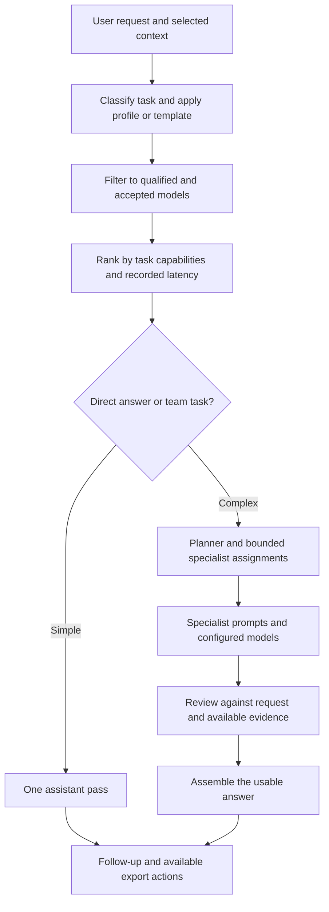

# How OYYO selects models and agents

A user should be able to ask in ordinary words: “Plan my launch, prepare the posts and give me a budget.” Model selection, prompt preparation and bounded specialist work sit behind that request.

## The execution path

## Model selection

The Windows runtime classifies requests into categories such as coding, mathematics, engineering, marketing, finance, HR, meetings, writing and research. It ranks eligible models using matching capability labels, parameter-class weighting, recorded qualification latency and a small saved-preference weight. This is a practical heuristic, not a guarantee of the world's best model or a semantic evaluator of every possible task.

Only compatible, qualified and accepted local models may be selected for local inference. A model that fits estimated RAM still needs the quality gate. An explicitly configured unavailable model can block a role; silently treating a failed job as successful is not an acceptable fallback.

## Agent roles are independent of model names

The current runtime has **200 role definitions** and **1,025 task templates**. Those are catalog counts, not 200 concurrent model processes. A planner, copywriter, financial modeller and reviewer can all use one qualified model in separate passes. Role-specific settings can instead assign different qualified models to different jobs.

Teams use bounded specialist assignments, review and synthesis. Saved custom teams support up to four selected specialists plus their configured reviewer. Optional specialist parallelism is resource-limited; it is not unrestricted simultaneous execution of the entire role catalog.

Supported workflow groups include everyday work, marketing, finance, HR, engineering, research and operations. Other company roles are represented through the role catalog and templates rather than a separately trained model for every job title.

## Prompt preparation

OYYO combines the actual request, relevant source excerpts, allowed memory, recent conversation, selected template, role instructions and model-specific formatting. Category instructions ask for usable copy, reconciled finances, grounded research or concrete code and verification as appropriate.

A profile can set tone, format, team and reusable instructions. A custom template can turn a brief into a consistent deliverable. Per-agent settings can control instructions, model selection, answer budget and sampling. The dashboard `@` picker lets users explicitly select agents, teams, profiles, templates, notes, memory and qualified models. Run settings are snapshotted so later edits do not rewrite earlier execution records.

## Memory and local notes

Saved memory is shared across workspaces; conversation history belongs to its chat. Relevant retrieval and selected source context are separate from the model weights. A text model does not permanently learn a new company fact merely because it appeared in a prompt.

In the Windows 0.1.14 baseline, NotzUp note-processing jobs, explicitly selected note context and their linked chat continuations use the local-only execution policy even if connected assistance is enabled. They require a qualified local text model. Failed local processing does not automatically send the meeting to a connected provider.

## Results and control

The user can inspect the real plan, participating roles, status and specialist contributions. Queued or planned nodes are not completed work. A model review is another inference pass; it is not independent proof that facts are true, a tool ran, code passed tests or a social post was published.

Connected assistance is optional and uses a connected account. It is not local inference or an offline substitute. Keep execution mode understandable and obtain appropriate authorisation before sending private context to connected services.
