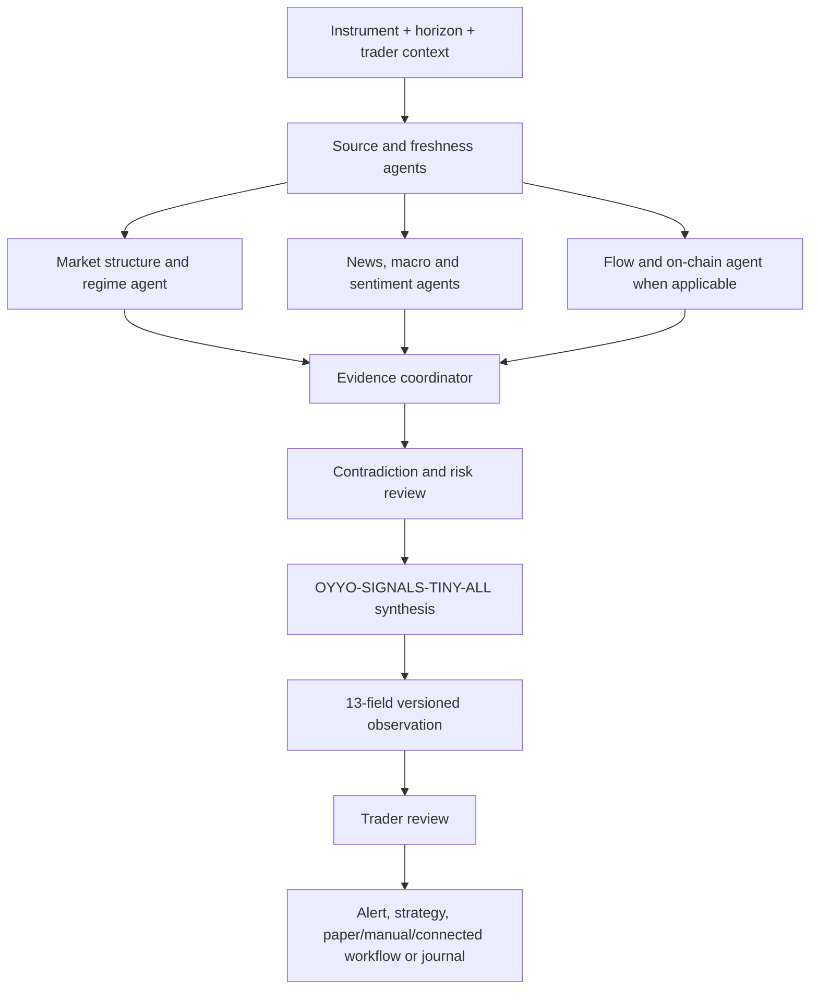
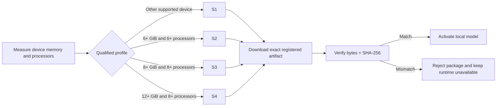

# OYYO-SIGNALS-TINY-ALL

> Local market-intelligence model family for OYYO Signals, with device-qualified S1–S4 artifacts.

| Identity | Value |
| --- | --- |
| Public family name | `OYYO-SIGNALS-TINY-ALL` |
| Current runtime compatibility ID | `OYYO-SIGNAL-TINY-ALL` |
| Product | [OYYO Trade Signals](https://github.com/vpicciuolo/oyyo-trade-signals) |
| Surfaces | Desktop, Android, iOS and qualified local runtimes; web account/control plane |
| Output | Versioned, evidence-rich 13-field market observation |
| Execution boundary | Intelligence and decision support; deterministic controls govern every eligible action |
| Model-card revision | 1.0.0 · 16 November 2026 |

The plural public name identifies the complete customer-facing family. The singular runtime ID remains documented because current application builds use it for package storage and compatibility. They refer to the same Signals model family.

## What the model does

OYYO-SIGNALS-TINY-ALL turns selected market context into a structured observation that a trader can inspect. It coordinates bounded analysis responsibilities rather than returning an unexplained buy/sell label.

- Reads instrument, venue, horizon, session, price and market-structure context.
- Interprets timestamped news, macro events, sentiment, flow and on-chain context when available and permitted.
- Separates supporting evidence from opposing evidence.
- Checks freshness, missing inputs, contradictions and risk conditions.
- Produces a descriptive `bullish`, `bearish` or `neutral` market-state label.
- Records uncertainty, limitations, sources, provenance and exact model/workflow identity.
- Supports research, alerts, strategy work, paper scenarios and journal review across OYYO Signals.

It does not determine personal suitability, guarantee an outcome or bypass connector permissions and deterministic risk controls.

## How OYYO intelligence works



Each agent has a narrow responsibility. The coordinator preserves disagreement instead of averaging it away. The synthesis layer must show what supports the observation, what challenges it, which inputs were used, how fresh they are and what remains uncertain.

## The 13-field signal contract

| Field | Customer meaning |
| --- | --- |
| `timestamp` | When the observation was created |
| `horizon` | Time horizon used for the analysis |
| `instrument` | Market instrument being observed |
| `market_state_label` | Descriptive `bullish`, `bearish` or `neutral` state |
| `uncertainty` | Explicit uncertainty statement or measure |
| `sources` | Named inputs used |
| `data_freshness` | Source-age and timestamp context |
| `supporting_evidence` | Evidence consistent with the observed state |
| `opposing_evidence` | Evidence challenging the observed state |
| `limitations` | Known data, method and scope limitations |
| `model_version` | Exact artifact/workflow identity |
| `provenance` | `simulated`, `paper` or `live-data` |
| `notice` | Informational market analysis — not an instruction to transact. |

## Technical specification

The public repository documents the operational contract without publishing proprietary weights or inventing unverified architecture data.

| Specification | Public value |
| --- | --- |
| Model family | OYYO-SIGNALS-TINY-ALL |
| Artifact variants | S1, S2, S3, S4 |
| Package identity | One exact artifact per variant and release |
| Mobile package container | Versioned `.bin` package |
| Parameter count | Artifact-specific proprietary release metadata; not disclosed in the public repository |
| Quantization | Artifact-specific release metadata; exact value is bound to the signed release manifest |
| Context/input limits | Runtime- and workflow-version specific; displayed by the qualified application |
| Package bytes | Exact integer recorded per artifact release |
| Integrity | SHA-256 over the complete artifact; 64 hexadecimal characters |
| Download transport | HTTPS, resumable with byte ranges |
| Activation rule | Exact byte length and SHA-256 must both match |
| Local storage | Customer device application storage |
| Output schema | OYYO Signals 13-field contract |
| Provenance | Model artifact, workflow, runtime, sources and result provenance retained with the observation |

Parameter count and quantization are not inferred from a filename. An OYYO release is identified by its model version, variant, exact byte length, SHA-256, quantization/conversion record, runtime compatibility and workflow version. This prevents a similarly named but different file from being represented as the approved model.

## S1–S4 variants

S1–S4 let OYYO install the artifact appropriate for the measured device while preserving the same customer-facing signal contract.

| Variant | Android selection threshold | Why it exists |
| --- | --- | --- |
| **S1** | Device does not meet a higher tier | Smallest device profile and broadest compatibility |
| **S2** | At least 6 GiB total memory and 6 available processors | Balanced profile for capable mobile devices |
| **S3** | At least 8 GiB total memory and 8 available processors | Higher local compute profile |
| **S4** | At least 12 GiB total memory and 8 available processors | Highest current Android device profile |

Selection is evaluated in descending order, so an S4-capable device receives S4. These are compute profiles, not promises that a higher number will predict markets better. Desktop and iOS qualification can use platform-specific measurements while retaining the S1–S4 family names and the same output contract.



## Installation and verification

1. OYYO measures the local device and selects S1, S2, S3 or S4.
2. The application resolves the registered HTTPS artifact for that variant.
3. An interrupted download resumes from the verified partial byte position.
4. The application rejects a payload larger than the registered size.
5. The complete package must match both the exact byte count and SHA-256.
6. Only a verified package is atomically activated.
7. The runtime reports the active variant and local package size.
8. Saved observations retain the model/workflow identity required for later review.

A missing or invalid manifest never silently falls back to an unrelated model.

## How the model supports trading modes

| Mode | Role of OYYO-SIGNALS-TINY-ALL | Customer and control boundary |
| --- | --- | --- |
| Research | Produces evidence-rich observations and scenario context | No order is created |
| Paper | Supplies context for simulated tickets, positions and journal review | Local paper ledger and paper-risk limits |
| Manual | Prepares inspectable context for an eligible ticket | Trader submits the exact ticket |
| Supervised | Prepares a bounded intent and its evidence | Trader approves the exact intent |
| Automatic | Evaluates only inside a customer-enabled strategy envelope | Connector permissions, deterministic limits and kill switch remain authoritative |

Model output alone never grants execution authority. Availability of connected modes depends on the installed application, eligible local connector, customer permissions, region, policy and release configuration.

## Markets and connectors

The model can work with normalized, timestamped inputs for crypto venues, gold, forex, indices, macro calendars, news, sentiment, public on-chain/flow sources and customer-enabled broker or exchange connectors. Connector credentials stay in the device secure store. OYYO records venue, source time, received time and freshness so a stale or missing feed cannot appear current.

MT5-compatible bridges and crypto-exchange adapters are connector boundaries, not part of the model weights. They provide normalized data or receive an already governed intent; they do not override the model contract or risk engine.

## Versioning and reproducibility

A complete observation can retain:

```text
application version
+ signal-schema version
+ model family and artifact version
+ S1/S2/S3/S4 variant
+ quantization/conversion identity
+ exact artifact SHA-256
+ runtime/backend version
+ agent workflow version
+ catalog version
+ provider/source timestamps
+ simulated, paper or live-data provenance
```

Changing weights, quantization, conversion, runtime compatibility or the material workflow creates a new artifact or workflow identity. Documentation-only changes do not relabel historic output.

## Why this design

- **Explainable by contract:** evidence, counter-evidence, uncertainty and limitations are mandatory.
- **Device-aware:** one product family scales across local hardware profiles.
- **Verifiable:** an artifact is activated only after size and SHA-256 checks.
- **Reviewable:** model and workflow identity travel with the observation.
- **Connector-neutral:** normalized inputs and governed intents keep venues separate from intelligence.
- **Risk-bounded:** AI output cannot bypass deterministic controls or the kill switch.
- **Private by design:** qualified inference and trading state can remain on the customer device.

## Limits and responsible use

Markets are uncertain. OYYO-SIGNALS-TINY-ALL is decision-support software, not investment advice, a broker, a custodian, a guarantee of performance or an instruction to transact. Data can be delayed, incomplete or wrong. Model output can be wrong. Traders must verify sources, understand connector behavior, apply independent judgment and use appropriate risk controls. Past, paper or simulated results do not indicate future results.

## Related documentation

- [OYYO Trade Signals customer information](https://github.com/vpicciuolo/oyyo-trade-signals)
- [Signals, models and provenance](https://github.com/vpicciuolo/oyyo-trade-signals/blob/main/docs/SIGNALS-AND-MODELS.md)
- [Agents and intelligence](https://github.com/vpicciuolo/oyyo-trade-signals/blob/main/docs/AGENTS-AND-INTELLIGENCE.md)
- [Trading modes](https://github.com/vpicciuolo/oyyo-trade-signals/blob/main/docs/TRADING-MODES.md)
- [Connectors and venues](https://github.com/vpicciuolo/oyyo-trade-signals/blob/main/docs/CONNECTORS-AND-VENUES.md)
- [OYYO Models](https://github.com/vpicciuolo/oyyo-models)

Copyright © 2026 OYYO · HRN INNOVATION TECHNOLOGIES LTD. All rights reserved.
